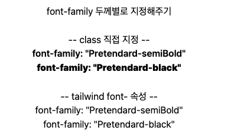
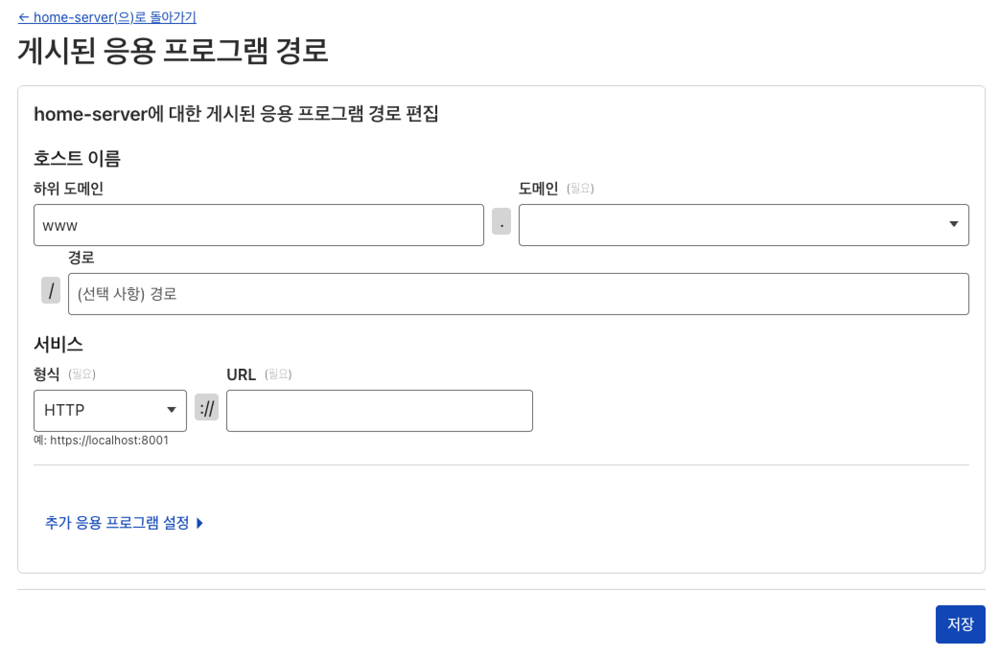

# 저의 효도 프로젝트 unisize에게 드디어 이름이 생겼어요.

## 도메인부터 냅다 사버리기

클라우드 플레어 가입하고, 간지나보이는 도메인으로 바로 사버렸다

### [트러블슈팅01] 냅다 배포 금지

먼저 내 프로젝트는 프론트와 백 모두 홈서버에 1차 배포가 되어있다.
도메인을 사고 흐름따라 깃허브 레포 연결하고, 진행하다보면 vercel올리듯이 배포가 되는데
개인적인 프로젝트면 아주 편했겠지만 나는 홈서버에 배포된 아이를 배포해야하기 때문에 다급히 빌드 취소를 눌러줬다

## 터널링하기

1. https://one.dash.cloudflare.com/ 에서 우선 터널부터 생성해줬다.
2. 터널이름을 지어주고
3. 홈서버에 클라우드플레어를 설치해주었다
 

### [트러블슈팅02] 어,,? cname, a, aaaa 네? www 안된다고요? 뭐가 권장인데요..?

분명 정처기 필기하고, 취업 전에 cs공부하면서 공부했을 dns,, 막상 적용하려고 보니 뭐가 뭔지 일도 모르겠더군요..
불안한 마음에 *(와일드카드)도 해보고 cname, a해서 중복으로 dns지정하려다가 실패하고,,
1시간의 사투 끝에 기존에 이것저것 지정한 dns지워버리고 하위도메인에 www 지정하고 끝나버린 상황에 대해서
아주 즐거웠습니다.    
[DNS란](https://www.cloudflare.com/ko-kr/learning/dns/what-is-dns/) 여기 보면서 공부하고, 단어가 단어의 꼬리를 물어서 공부하고, 이번 기회에 프론트엔드 개발자로서 네트워크도 공부해야겠다는 생각이..!
## 여튼 잘 올라갔다
홈서버 ip주소로 들어가지 않아도 이제 어디든 마음대로 보여줄 수 있다는게 행복아니겠습니까
   마치 초등학생이 된 자식을 본 마음으로 이제 이것저것 사주듯이 보안적으로도 어떻게 할 수 있을지 고민도 해보고    클라우드플레어, 터널링, dns를 잘 몰랐던 수치를 잊어버리기 위해 공부도 하고    매일 작업하고 있으니깐 블로그도 잘 써봅시다